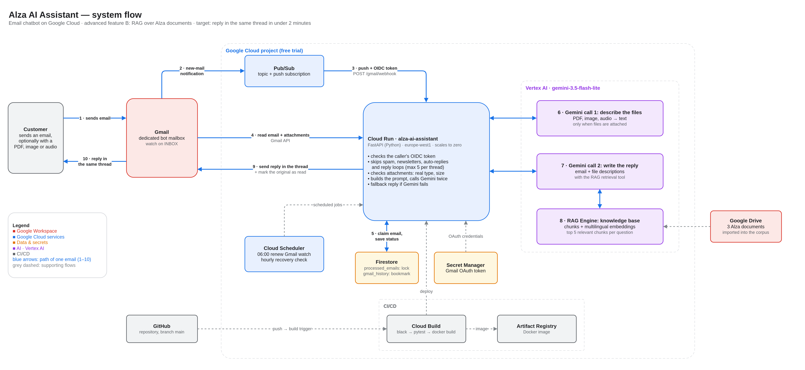

# Alza AI Assistant (AI Engineer assignment)

## Description

The goal is an AI chatbot that works over email, built on Google Cloud Platform with
RAG. People send an email to the bot's Gmail address and get an AI reply in the same
thread. They can ask anything. Questions about Alza products,
services and policies are answered from Alza's documents (RAG over a Vertex AI RAG
Engine corpus). Attachments (PDF, images, audio, plain text) are read too.

Stack: Gmail API, Pub/Sub, Cloud Run (FastAPI), Firestore, Gemini on Vertex AI,
Vertex AI RAG Engine, Cloud Scheduler, Secret Manager, Cloud Build.

## Workflow



How it works (the numbers match the diagram):

1. A customer emails the bot's Gmail address, optionally with a PDF, image or audio
   attachment.
2. Gmail `users.watch` publishes a new-mail notification to Pub/Sub.
3. Pub/Sub pushes the notification to Cloud Run (`POST /gmail/webhook`) with an OIDC
   token. The app checks the token, so only the invoker service account can call it.
4. The app reads the new email and its attachments through the Gmail API. It skips
   mail it should not answer: spam, newsletters, auto-replies, and threads that
   already have 5 bot replies. It also checks each attachment's real type and size.
5. The email is claimed in Firestore, so it is never answered twice. Its status is
   saved there at the end.
6. Gemini call 1 turns file attachments into text. It runs only when files are
   attached, because Vertex AI does not allow files and the RAG tool in one request.
7. Gemini call 2 writes the reply from the email and the file descriptions.
8. Call 2 uses the RAG retrieval tool over the knowledge base: the Alza documents
   imported from Google Drive. If Gemini fails, the customer gets a fallback reply.
9. The reply is sent in the same thread with an "AI Digital Mark", and the original
   email is marked as read.
10. The customer gets the reply in the same thread.

Supporting flows:

- Cloud Scheduler renews the Gmail watch daily at 6:00. Every hour it runs a recovery
  check over all unread mail, which catches lost notifications and retries emails
  that failed to send.
- Secret Manager holds the Gmail OAuth credentials.
- A push to GitHub `main` builds and deploys the app through Cloud Build.

## Settings

One-time setup in the GCP project (region `europe-west1`):

1. **APIs:** enable Gmail, Pub/Sub, Cloud Run, Firestore, Vertex AI, Cloud Scheduler,
   Secret Manager, Cloud Build and Artifact Registry.
2. **Service accounts:**
   - `alza-ai-assistant-runtime` runs the app. It needs access to Firestore, Vertex AI
     and the Gmail secrets.
   - `gmail-pubsub-invoker` calls the app. It needs `run.invoker` on the service.
3. **Gmail OAuth:** create an OAuth client for the bot's mailbox with the `gmail.modify`
   scope. Then run `token-refresh/get_token.py`, which stores `gmail-client-id`,
   `gmail-client-secret` and `gmail-oauth-refresh-token` in Secret Manager. While the
   consent screen is in Testing mode, the refresh token expires after 7 days, so run
   the script again when it does.
4. **Pub/Sub:**
   - Create a topic for Gmail notifications and allow
     `gmail-api-push@system.gserviceaccount.com` to publish to it.
   - Create a push subscription to `<SERVICE_URL>/gmail/webhook` that authenticates
     as `gmail-pubsub-invoker`.
5. **Firestore:** a database in Native mode. Optionally, add a TTL policy on
   `processed_emails.updated_at`.
6. **RAG:** create a Vertex AI RAG Engine corpus and import the Alza documents from
   Google Drive. To inspect it, run `python -m scripts.get_rag_info`.
7. **Cloud Scheduler:** both jobs send OIDC tokens as `gmail-pubsub-invoker`.
   - `gmail-renew-watch` runs daily (`0 6 * * *`) and calls
     `/internal/gmail/renew-watch`.
   - `gmail-recovery-check-inbox` runs hourly (`0 * * * *`) and calls
     `/internal/gmail/recovery-check-inbox`.
8. **Cloud Run env vars:** set the variables from [.env.example](.env.example) on the
   service. The `GMAIL_*` values come from Secret Manager.
9. **Cloud Build:**
   - Create a trigger on this repo for branch `^main$` that uses `/cloudbuild.yaml`.
   - The trigger's service account needs Cloud Run Admin, Artifact Registry Writer and
     Service Account User on `alza-ai-assistant-runtime`.
   - The Artifact Registry repository `cloud-run-source-deploy` must exist.

## Test locally

Install the dependencies and fill in `.env`. Firestore and Vertex AI use your
Application Default Credentials (`gcloud auth application-default login`).

```bash
python3.12 -m venv .venv
.venv/bin/pip install -r requirements-cloudbuild.txt
cp .env.example .env            # fill in values; the Gmail ones are below
for pair in GMAIL_CLIENT_ID:gmail-client-id GMAIL_CLIENT_SECRET:gmail-client-secret \
            GMAIL_OAUTH_REFRESH_TOKEN:gmail-oauth-refresh-token; do
  echo "${pair%%:*}=$(gcloud secrets versions access latest --secret=${pair#*:})" >> .env
done
```

Then send an email to the bot's mailbox and run the script. It answers the oldest
unread email end to end, with the same filters and processing as the webhook:

```bash
.venv/bin/python -m scripts.run_once            # answer one unread email
.venv/bin/python -m scripts.run_once_recovery   # same, also retries FAILED emails
```

Unit tests and formatting (Gmail, Firestore and Gemini are mocked):

```bash
.venv/bin/black .
.venv/bin/pytest
```

## Deploy

Push to `main`:

```bash
git push origin main
```

The Cloud Build trigger runs `cloudbuild.yaml`. The steps are `black --check`, then
`pytest`, then the Docker build and push to Artifact Registry, and then the deploy of
the `alza-ai-assistant` Cloud Run service. An unformatted push or a failing test stops
the build and nothing is deployed.
